# Plomada: documento de arquitectura de software

<!-- pdf:omitir -->

Fuente del documento de arquitectura (SAD) del taller práctico de Ingeniería de Software Orientado a Objetos. El PDF se genera desde este archivo con `pnpm --filter @plomada/docs pdf`. Los diagramas están en `docs/diagramas/` como fuentes D2 y se renderizan a SVG con `pnpm --filter @plomada/docs diagramas`.

| Ítem | Contenido                           | Responsable  | Estado    |
| ---- | ----------------------------------- | ------------ | --------- |
| 1    | Atributos de calidad                | A            | Borrador  |
| 2    | Limitaciones técnicas y de negocio  | A            | Borrador  |
| 3    | Casos de uso                        | A            | Borrador  |
| 4    | Escenarios críticos                 | A            | Borrador  |
| 5    | Estilo arquitectónico               | A            | Borrador  |
| 6    | Diagrama de componentes             | B            | Borrador  |
| 7    | Entidad relación                    | B            | Borrador  |
| 8    | Justificación de la base de datos   | B            | Borrador  |
| 9    | Diagrama de despliegue e inventario | C            | Pendiente |
| 10   | Tecnologías                         | A, con B y C | Borrador  |
| 11   | Decisiones críticas                 | A integra    | En curso  |

<!-- /pdf:omitir -->

## Cómo leer este documento

El taller pide un documento de arquitectura con once ítems. Este documento los presenta con su misma numeración, del 1 al 11, precedidos de un capítulo de contexto que sigue el formato del documento de arquitectura (SAD) del curso: resumen ejecutivo, metas del negocio, stakeholders y escenarios funcionales. Las demás secciones propias del SAD quedan dentro del ítem al que corresponden.

| Pide el taller                        | Sección  | Partes del formato SAD incluidas                                                                    |
| ------------------------------------- | -------- | --------------------------------------------------------------------------------------------------- |
| Contexto                              | Contexto | Resumen ejecutivo, descripción, metas del negocio, stakeholders, propósito y escenarios funcionales |
| 1. Atributos de calidad priorizados   | 1        | Propiedades sistémicas (ISO/IEC 9126), escenarios de calidad priorizados, árbol de utilidades       |
| 2. Limitaciones técnicas o de negocio | 2        | Restricciones, deficiencias clave                                                                   |
| 3. Diagramas de caso de uso           | 3        |                                                                                                     |
| 4. Escenarios críticos                | 4        | Formato de escenarios operativos                                                                    |
| 5. Estilo arquitectónico              | 5        | Estilo arquitectónico propuesto, principios aplicados                                               |
| 6. Diagrama de componentes o paquetes | 6        |                                                                                                     |
| 7. Diagrama entidad relación          | 7        |                                                                                                     |
| 8. Justificación de la base de datos  | 8        |                                                                                                     |
| 9. Diagrama de despliegue             | 9        | Diagrama de despliegue, inventario de recursos                                                      |
| 10. Tecnologías utilizadas            | 10       |                                                                                                     |
| 11. Decisiones críticas               | 11       | Una nota por decisión: problema, opciones evaluadas, opción seleccionada y por qué                  |
| Método de priorización                | Anexo A  | QAW                                                                                                 |
| Vocabulario                           | Anexo B  | Glosario                                                                                            |

## Contexto

### Resumen ejecutivo

Una empresa de mantenimiento locativo presta servicios de piscina, pintura, jardinería y otros trabajos a conjuntos cerrados de propiedad horizontal. Cada semana, el administrador programa a unos 150 operarios indicando, de lunes a viernes, el conjunto donde trabajan y las actividades que deben realizar. Hoy no hay un registro confiable de cuándo llegó cada operario, cuándo empezó y terminó cada actividad, ni de cómo quedó el trabajo, y el supervisor que lo revisa en persona no tiene dónde dejar su decisión.

Plomada es el sistema que cierra ese ciclo: publica la programación semanal y la envía por correo a cada operario, registra la jornada, recoge las fotos de antes, durante y después de cada actividad y deja constancia de la revisión del supervisor. La condición que domina el diseño es que los operarios trabajan con su celular personal, de gama baja o media, sin datos móviles y en lugares sin internet garantizado. Por eso el sistema funciona primero sin conexión: todo lo que hace el operario queda guardado en su teléfono y se sincroniza cuando hay red, sin perder ni duplicar nada.

La arquitectura elegida es un monolito modular con arquitectura hexagonal dentro de cada módulo, con un cliente web progresivo (PWA) que funciona sin conexión, una base de datos PostgreSQL y almacenamiento de fotos en disco. Se despliega en local, como permite el taller.

### Título y descripción del proyecto

**Título:** Plomada, sistema de programación, jornada y evidencia fotográfica para el mantenimiento locativo de conjuntos cerrados.

**Descripción:** el sistema atiende cuatro roles. El administrador gestiona usuarios y, junto con los administrativos, crea y publica la programación semanal, mantiene los centros de trabajo y las hojas de vida, y consulta el seguimiento. El supervisor revisa en sitio las actividades con su evidencia y las aprueba o las rechaza con una observación. El operario consulta su programación, registra la entrada y la salida del centro y el inicio y el fin de cada actividad, y toma las fotos, todo desde su celular y sin depender de la conexión. El nombre viene de la plomada, la herramienta con la que se verifica que un muro quedó a nivel: el supervisor contrasta el trabajo contra la evidencia.

### Metas del negocio

1. Contar con evidencia fechada y verificable del trabajo realizado en cada actividad, con fotos de antes, durante y después.
2. Controlar el horario de cada operario: entrada y salida del centro de trabajo, e inicio y fin de cada actividad.
3. Programar la semana y comunicarla a cada operario por su correo institucional, sin llamadas ni mensajes sueltos.
4. Conocer el avance del día por centro de trabajo y por operario.
5. Registrar la revisión del supervisor con su decisión y su observación, como respaldo ante el conjunto cerrado.
6. Centralizar las hojas de vida de los operarios.

### Stakeholders

| Stakeholder                            | Justificación                                                                                                                                                  |
| -------------------------------------- | -------------------------------------------------------------------------------------------------------------------------------------------------------------- |
| Gerencia de la empresa (administrador) | Responde ante los conjuntos por la calidad del servicio. Espera control del horario, evidencia del trabajo y una programación que llegue a todos sin esfuerzo. |
| Administrativos (unos 20)              | Programan la semana, mantienen centros y hojas de vida y consultan el avance. Esperan rapidez y pocas operaciones.                                             |
| Supervisores (unos 30)                 | Revisan el trabajo en persona. Esperan ver la evidencia en su tablet o teléfono y registrar su decisión en sitio.                                              |
| Operarios (unos 150)                   | Ejecutan las actividades con su propio celular. Esperan una aplicación sencilla que no gaste datos, no pierda su trabajo y no exija un teléfono nuevo.         |
| Conjuntos cerrados (clientes)          | No usan el sistema en esta versión, pero son la razón de la evidencia: el respaldo ante un reclamo sale de aquí.                                               |
| Docente del curso                      | Evalúa que la arquitectura se sustente en los principios vistos y que al menos dos módulos funcionen en local.                                                 |
| Equipo de desarrollo                   | Tres estudiantes: arquitectura y documentación (Brayan Toro), backend y datos (Juan Camilo Mora) y cliente móvil y sincronización (Pablo Trujillo).            |

### Propósito y escenarios funcionales

El propósito es que la empresa sepa, con evidencia, qué se hizo, dónde y cuándo, aunque quien lo hizo haya trabajado sin conexión. Del enunciado se desprenden estos escenarios funcionales, que guían los escenarios de calidad del ítem 1:

1. Un operario sin conexión puede consultar su programación, registrar horas y tomar fotos durante al menos 48 horas.
2. Lo capturado sin conexión llega al servidor una sola vez, aunque el envío se interrumpa y se repita.
3. Cada hecho conserva la hora en que ocurrió y la hora en que llegó al servidor.
4. El supervisor revisa la evidencia desde una tablet o un teléfono y decide en sitio; un rechazo exige observación.
5. Al publicar la programación, cada operario recibe un correo con sus asignaciones sin que el envío retrase la publicación.
6. El sistema soporta 200 cuentas y el pico del cierre de jornada, con 150 operarios sincronizando en media hora.
7. Solo entran usuarios autenticados con su correo institucional, y cada rol ve y hace únicamente lo que le corresponde.
8. Las fotos no se reemplazan ni se borran desde la aplicación.
9. El seguimiento del día refleja lo que llegó al servidor con un retraso máximo de 15 segundos.
10. Cambiar el almacenamiento de fotos o el servidor de correo no exige modificar las reglas de negocio.

## 1. Atributos de calidad priorizados

### Supuestos de volumen

El enunciado no da cifras de uso, así que los objetivos se calculan sobre supuestos explícitos del equipo. Se asumen unas 200 cuentas (1 administrador, 20 administrativos, 30 supervisores y 150 operarios), hasta 6 actividades por operario al día y 3 fotos por actividad. Eso son 150 × 6 × 3 = 2.700 fotos diarias; con unos 400 KB por foto tras la compresión, alrededor de 1,1 GB al día, 5,4 GB a la semana y unos 280 GB al año. Si el 80 % de los operarios sincroniza en la media hora posterior al cierre de la jornada, llegan en promedio 1,2 fotos por segundo, y el sistema se diseña para sostener 5 por segundo, cuatro veces ese promedio. Los 30 supervisores consultando cada 12 segundos suman unas 2,5 peticiones por segundo.

### Lo que el taller pide medir

| Aspecto                 | Objetivo                                                                                                                                                                                                                                                                                                                                                                          | Cómo lo logra la arquitectura                                                                                          | Escenario    |
| ----------------------- | --------------------------------------------------------------------------------------------------------------------------------------------------------------------------------------------------------------------------------------------------------------------------------------------------------------------------------------------------------------------------------- | ---------------------------------------------------------------------------------------------------------------------- | ------------ |
| Tiempos de respuesta    | En el servidor, p95 de 500 ms en consultas y registros, 1 s en el inicio de sesión (el hash es lento a propósito) y 2 s para procesar una foto de 400 KB. En el celular, toda acción del operario responde en menos de 100 ms.                                                                                                                                                    | Las acciones del operario terminan contra el almacenamiento local; la sincronización corre aparte.                     | EC-05        |
| Número de usuarios      | 200 cuentas. En el pico, 150 operarios sincronizando en 30 minutos (5 fotos por segundo sostenidas) y 30 supervisores consultando a la vez. Crecer al doble sin cambiar la arquitectura.                                                                                                                                                                                          | Un solo proceso que escala verticalmente, con una carga muy por debajo de sus límites.                                 | EC-05        |
| Autenticación y cifrado | Correo institucional y contraseña con hash argon2id. Token de acceso firmado de 15 minutos y token de renovación rotativo de 7 días, guardado solo como hash. TLS 1.2 o superior en tránsito en producción, que queda fuera de v1: la demostración local corre por HTTP en `localhost`. Fotos servidas solo con token. Cifrado en reposo delegado al disco del sistema operativo. | Módulo `identidad`; el rol se comprueba en el router y la propiedad del recurso en los casos de uso (notas 006 y 014). | EC-03, EC-04 |
| Tiempo en línea         | 99,5 % en horario laboral (lunes a viernes, 6:00 a 18:00), unas 1,3 horas de caída al mes. Tras una caída, el servicio vuelve en menos de 5 minutos.                                                                                                                                                                                                                              | El cliente trabaja sin servidor, así que la disponibilidad que percibe el operario es mayor que la del servidor.       | EC-01, EC-08 |

La disponibilidad del servidor no está entre las primeras prioridades, y es a propósito. Como el operario trabaja y acumula en su celular aunque el servidor esté caído, una caída corta retrasa la sincronización pero no detiene a nadie. Eso permite un despliegue local de un solo servidor sin redundancia, que es lo que admite el taller.

### Propiedades sistémicas

El curso usa el modelo de calidad ISO/IEC 9126, y este documento conserva su vocabulario. Su sucesora, ISO/IEC 25010, agrupa las mismas ideas con otros nombres; ninguna conclusión cambia por ello.

| Característica | Subcaracterística                        | Qué significa en Plomada                                                              | Prioridad | Escenario    |
| -------------- | ---------------------------------------- | ------------------------------------------------------------------------------------- | --------- | ------------ |
| Fiabilidad     | Tolerancia a fallos                      | Trabajar sin conexión y sin servidor sin perder ni duplicar datos                     | Alta      | EC-01        |
| Fiabilidad     | Capacidad de recuperación                | Tras una caída, el servidor vuelve y las colas de los celulares se vacían solas       | Media     | EC-08        |
| Funcionalidad  | Precisión                                | Cada hecho con su hora capturada y su hora recibida; el estado derivado de los hechos | Alta      | EC-02        |
| Funcionalidad  | Seguridad                                | Autenticación, autorización por rol y credenciales protegidas                         | Alta      | EC-03, EC-04 |
| Funcionalidad  | Interoperabilidad                        | Correo por SMTP y funcionamiento en navegadores de Android e iOS                      | Media     | EC-10        |
| Eficiencia     | Comportamiento en el tiempo              | Respuestas rápidas aun en el pico de cierre de jornada                                | Media     | EC-05        |
| Eficiencia     | Utilización de recursos                  | Poca memoria, poco almacenamiento y pocos datos en celulares de gama baja             | Alta      | EC-06        |
| Mantenibilidad | Cambiabilidad                            | Cambiar la infraestructura sin tocar las reglas de negocio                            | Media     | EC-07        |
| Mantenibilidad | Facilidad de prueba                      | Dominio y casos de uso probados sin base de datos                                     | Media     | EC-07        |
| Usabilidad     | Operatividad y facilidad de aprendizaje  | Pocas acciones por actividad, para usuarios con poca experiencia digital              | Media     | EC-09        |
| Portabilidad   | Adaptabilidad y facilidad de instalación | Cualquier navegador moderno, en teléfono o tablet, sin tienda de aplicaciones         | Baja      | EC-10        |

### Escenarios de calidad priorizados

Cada escenario sigue la estructura de seis partes del curso: fuente, estímulo, artefacto, ambiente, respuesta y medida de la respuesta. A diferencia de una descripción general, la medida es una cifra que se puede comprobar.

**EC-01. Tolerancia a la desconexión.** Prioridad alta. Stakeholder: operarios y gerencia.

| Parte                  | Descripción                                                                                                                                 |
| ---------------------- | ------------------------------------------------------------------------------------------------------------------------------------------- |
| Fuente                 | Operario en un centro de trabajo sin señal                                                                                                  |
| Estímulo               | Registra su jornada y toma las fotos de sus actividades durante dos días sin conexión; al volver la red, el enlace se corta varias veces    |
| Artefacto              | PWA, cola local y API de sincronización                                                                                                     |
| Ambiente               | Sin conexión hasta 48 horas y luego con red intermitente                                                                                    |
| Respuesta              | Todo queda guardado en el celular; al volver la red, la cola se envía en orden de captura y cada envío interrumpido se repite sin duplicar  |
| Medida de la respuesta | Cero fotos perdidas y cero duplicadas. Con una conexión estable de 1 Mbps, la cola de una jornada (18 fotos) se vacía en menos de 3 minutos |

**EC-02. Precisión de los registros.** Prioridad alta. Stakeholder: gerencia y supervisores.

| Parte                  | Descripción                                                                                                                                                 |
| ---------------------- | ----------------------------------------------------------------------------------------------------------------------------------------------------------- |
| Fuente                 | Celular con el reloj desajustado y conexión tardía                                                                                                          |
| Estímulo               | El registro de fin de una actividad llega al servidor cuatro horas después y antes que el de inicio                                                         |
| Artefacto              | Módulos `jornada` y `programacion`                                                                                                                          |
| Ambiente               | Sincronización diferida, fuera de orden                                                                                                                     |
| Respuesta              | El servidor guarda la hora capturada y la recibida sin corregir ninguna, y deriva el estado de la actividad a partir de los hechos, no del orden de llegada |
| Medida de la respuesta | El 100 % de los hechos tiene ambas horas. El estado final es el mismo con cualquier orden de llegada, comprobado por pruebas automatizadas                  |

**EC-03. Control de acceso por rol.** Prioridad alta. Stakeholder: gerencia.

| Parte                  | Descripción                                                                                                                  |
| ---------------------- | ---------------------------------------------------------------------------------------------------------------------------- |
| Fuente                 | Usuario sin sesión, o un operario autenticado                                                                                |
| Estímulo               | Intenta revisar una actividad o crear un usuario                                                                             |
| Artefacto              | API, casos de uso de `evidencias` e `identidad`                                                                              |
| Ambiente               | Operación normal                                                                                                             |
| Respuesta              | La petición se rechaza con `no_autenticado` o `sin_permiso` y no cambia ningún dato                                          |
| Medida de la respuesta | El 100 % de las rutas, salvo el inicio de sesión y la de salud, exige token; cada regla de rol tiene una prueba automatizada |

**EC-04. Protección de credenciales.** Prioridad alta. Stakeholder: gerencia y operarios.

| Parte                  | Descripción                                                                                                                                                                                       |
| ---------------------- | ------------------------------------------------------------------------------------------------------------------------------------------------------------------------------------------------- |
| Fuente                 | Persona con acceso a una copia de la base de datos                                                                                                                                                |
| Estímulo               | Lee las tablas de usuarios y de sesiones                                                                                                                                                          |
| Artefacto              | Base de datos, módulo `identidad`                                                                                                                                                                 |
| Ambiente               | Operación normal, respaldo filtrado                                                                                                                                                               |
| Respuesta              | Encuentra hashes argon2id de las contraseñas y hashes de los tokens de renovación, nunca valores utilizables                                                                                      |
| Medida de la respuesta | Ninguna credencial ni token vigente recuperable desde la base. En producción todo el tráfico iría por TLS 1.2 o superior; queda fuera de v1 y la demostración local corre por HTTP en `localhost` |

**EC-05. Respuesta en el pico de cierre de jornada.** Prioridad media. Stakeholder: supervisores y administrativos.

| Parte                  | Descripción                                                                                                  |
| ---------------------- | ------------------------------------------------------------------------------------------------------------ |
| Fuente                 | 30 supervisores y 150 operarios                                                                              |
| Estímulo               | Los supervisores consultan la cola de revisión cada 12 segundos mientras los operarios sincronizan sus fotos |
| Artefacto              | API y base de datos                                                                                          |
| Ambiente               | Pico de carga: los 30 minutos posteriores al cierre de la jornada                                            |
| Respuesta              | Se atienden todas las peticiones sin errores por carga                                                       |
| Medida de la respuesta | p95 de 500 ms en consultas y registros, y de 2 s por foto de 400 KB, sosteniendo 5 fotos por segundo         |

**EC-06. Uso de recursos en gama baja.** Prioridad alta. Stakeholder: operarios.

| Parte                  | Descripción                                                                                                                                     |
| ---------------------- | ----------------------------------------------------------------------------------------------------------------------------------------------- |
| Fuente                 | Operario con un celular de gama baja                                                                                                            |
| Estímulo               | Abre la aplicación por primera vez y luego toma las fotos de una jornada                                                                        |
| Artefacto              | PWA                                                                                                                                             |
| Ambiente               | Primera visita con conexión; uso posterior sin ella                                                                                             |
| Respuesta              | La aplicación se instala y queda disponible sin conexión; las fotos se comprimen antes de guardarse                                             |
| Medida de la respuesta | Carga inicial de 500 KB comprimidos como máximo. Fotos de unos 400 KB y 1600 px en su lado mayor, con 1,5 MB como límite que acepta el servidor |

**EC-07. Cambio de infraestructura.** Prioridad media. Stakeholder: equipo de desarrollo y gerencia.

| Parte                  | Descripción                                                                                                              |
| ---------------------- | ------------------------------------------------------------------------------------------------------------------------ |
| Fuente                 | Equipo de desarrollo                                                                                                     |
| Estímulo               | Se decide guardar las fotos en un servicio de almacenamiento en la nube en vez del disco local                           |
| Artefacto              | Módulo `evidencias`                                                                                                      |
| Ambiente               | Mantenimiento                                                                                                            |
| Respuesta              | Se escribe un adaptador nuevo que implementa el puerto `AlmacenamientoEvidencias` y se conecta en la raíz de composición |
| Medida de la respuesta | Cero cambios en `domain/` y `application/`; las pruebas del dominio siguen pasando sin modificarse                       |

**EC-08. Recuperación tras una caída.** Prioridad media. Stakeholder: gerencia.

| Parte                  | Descripción                                                                                                                       |
| ---------------------- | --------------------------------------------------------------------------------------------------------------------------------- |
| Fuente                 | Falla del servidor o corte eléctrico                                                                                              |
| Estímulo               | El servidor deja de responder durante una hora en horario laboral                                                                 |
| Artefacto              | Servidor, API y clientes                                                                                                          |
| Ambiente               | Horario laboral                                                                                                                   |
| Respuesta              | Los operarios siguen trabajando sin conexión; al volver el servidor, las colas se vacían sin intervención                         |
| Medida de la respuesta | 99,5 % de disponibilidad en horario laboral, servicio restablecido en menos de 5 minutos tras la reparación y ningún dato perdido |

**EC-09. Operación por un usuario con poca experiencia.** Prioridad media. Stakeholder: operarios.

| Parte                  | Descripción                                                                                                     |
| ---------------------- | --------------------------------------------------------------------------------------------------------------- |
| Fuente                 | Operario con poca experiencia digital                                                                           |
| Estímulo               | Registra una actividad completa: inicio, tres fotos y fin                                                       |
| Artefacto              | PWA                                                                                                             |
| Ambiente               | En el centro de trabajo, con o sin conexión                                                                     |
| Respuesta              | Cada paso es una acción visible desde la actividad del día, con la cámara nativa del teléfono                   |
| Medida de la respuesta | La actividad completa toma menos de 2 minutos, con una demostración previa de 5 minutos como única capacitación |

**EC-10. Instalación sin tienda de aplicaciones.** Prioridad baja. Stakeholder: operarios y supervisores.

| Parte                  | Descripción                                                                       |
| ---------------------- | --------------------------------------------------------------------------------- |
| Fuente                 | Operario o supervisor con un teléfono Android o iOS                               |
| Estímulo               | Abre el enlace del sistema por primera vez                                        |
| Artefacto              | PWA                                                                               |
| Ambiente               | Primera visita con conexión                                                       |
| Respuesta              | El navegador ofrece instalar la aplicación en la pantalla de inicio               |
| Medida de la respuesta | Instalada en menos de 1 minuto, sin tienda de aplicaciones ni permisos especiales |

### Árbol de utilidades

El árbol resume la priorización. Cada hoja lleva dos letras entre paréntesis: la primera es la importancia para el negocio y la segunda la dificultad técnica, cada una alta (A), media (M) o baja (B). Las hojas (A, A) son las que más condicionan la arquitectura.

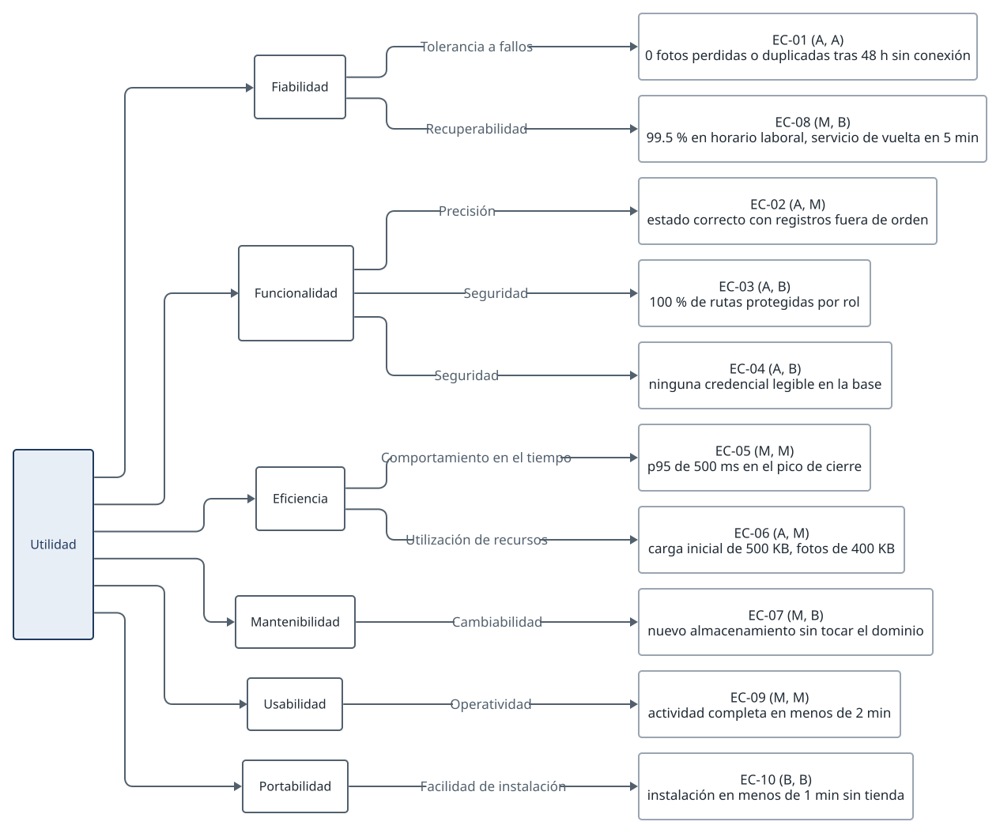

## 2. Limitaciones técnicas y de negocio

### Restricciones

| ID  | Restricción                                                                         | Tipo       | Establecida por | Alternativa considerada                       | Efecto en el diseño                                                    |
| --- | ----------------------------------------------------------------------------------- | ---------- | --------------- | --------------------------------------------- | ---------------------------------------------------------------------- |
| R1  | Operarios sin datos móviles ni internet garantizado en el sitio                     | Negocio    | Enunciado       | Exigir conexión o pagar datos a los operarios | Cliente que funciona primero sin conexión (nota 002)                   |
| R2  | Celulares personales de gama baja o media, heterogéneos y sin gestión de la empresa | Tecnología | Enunciado       | Aplicación nativa para Android                | PWA, compresión de fotos y cámara nativa                               |
| R3  | Despliegue local                                                                    | Tecnología | Taller          | Servicio en la nube                           | Un servidor, Docker Compose para la base de datos y el correo          |
| R4  | Al menos dos módulos funcionando                                                    | Negocio    | Taller          | Prototipo de todo el sistema                  | Recorrido mínimo vertical con prioridades P0 a P2 (nota 008)           |
| R5  | La IA se permite si cada decisión se sustenta en principios                         | Negocio    | Taller          | No usarla                                     | Decisiones registradas y reglas para agentes en `AGENTS.md`            |
| R6  | Cada operario necesita un correo institucional, creado por la empresa               | Negocio    | Enunciado       | Usuario y contraseña sin correo               | El correo identifica al usuario y recibe la programación               |
| R7  | Programación semanal, de lunes a viernes, hecha por la administración               | Negocio    | Enunciado       | Programación diaria                           | Una programación por semana, sin edición tras publicarla               |
| R8  | Tres fotos por actividad: antes, durante y después                                  | Negocio    | Enunciado       | Una foto final                                | Tres tipos de evidencia, con más de una foto por tipo                  |
| R9  | El supervisor revisa en persona                                                     | Negocio    | Enunciado       | Aprobación automática                         | La revisión registra la decisión del supervisor, no la reemplaza       |
| R10 | El service worker y `crypto.randomUUID()` exigen HTTPS o `localhost`                | Tecnología | Navegador       | Certificado local o túnel HTTPS               | La demostración corre en `localhost` con emulación de móvil            |
| R11 | Background Sync no existe en iOS                                                    | Tecnología | Plataforma      | Depender de Background Sync                   | Sincronización al abrir la aplicación, al volver la red y con un botón |
| R12 | El reloj del celular no es fiable                                                   | Tecnología | Dispositivo     | Corregir con la hora del servidor             | Hora capturada y hora recibida, sin corregir ninguna (nota 005)        |
| R13 | Almacenamiento del navegador limitado y que el sistema puede borrar                 | Tecnología | Navegador       | Guardar fotos sin comprimir                   | Compresión, pedido de almacenamiento persistente y aviso de pendientes |
| R14 | Equipo de tres personas, dos con poca experiencia en Git                            | Negocio    | Equipo          | Repositorios separados                        | Contrato como código, integración continua y carpetas con dueño        |

### Deficiencias clave

Hay riesgos que la arquitectura reduce pero no elimina. Se declaran para que nadie los dé por resueltos.

1. **Conectividad.** El seguimiento solo puede mostrar lo que ya llegó. Si un operario no encuentra red en todo el día, su avance aparece al final de la jornada. El sistema muestra la hora de la última sincronización de cada operario para que el supervisor sepa qué tan actual es lo que ve.
2. **Reloj del celular.** Un reloj muy desajustado produce una hora capturada dudosa que el sistema no detecta. Se muestran las dos horas para que la diferencia sea visible.
3. **Pérdida del celular antes de sincronizar.** Lo que no ha llegado al servidor se pierde con el teléfono o con el borrado de datos del navegador. Se reduce sincronizando en cada oportunidad, pidiendo almacenamiento persistente y mostrando al operario cuántos elementos tiene pendientes.
4. **Un solo servidor.** No hay redundancia. Un daño de disco pierde fotos y datos si no hay respaldo, así que la operación debe incluir una copia diaria de la base de datos y de la carpeta de fotos.
5. **Privacidad de las fotos.** Las fotos pueden mostrar personas de los conjuntos. Solo se sirven a usuarios autenticados, pero la política de cuánto tiempo se conservan la debe definir la empresa.
6. **Dependencia del correo institucional.** Un operario sin correo creado no puede entrar ni recibir su programación; la creación de cuentas es un paso de la empresa, no del sistema.

## 3. Casos de uso

Los casos de uso se presentan en dos diagramas, uno para la operación en campo y otro para la gestión, porque en uno solo las catorce asociaciones vuelven ilegible la figura. `Usuario` es un actor abstracto: operario, supervisor y administrativo lo especializan, y por eso todos inician sesión. El administrador especializa al administrativo, así que hace todo lo que este hace y además gestiona usuarios.

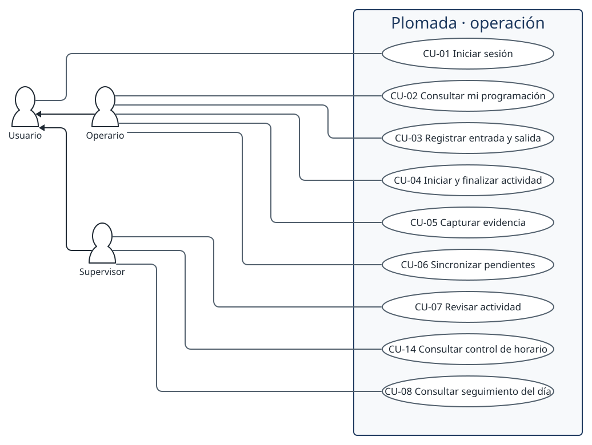

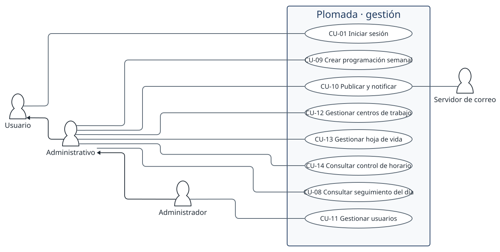

| Caso de uso                                                          | Actor principal             | Módulo                   | Prioridad |
| -------------------------------------------------------------------- | --------------------------- | ------------------------ | --------- |
| CU-01 Iniciar sesión con correo institucional y renovar la sesión    | Todos                       | `identidad`              | P0        |
| CU-02 Consultar la programación de la semana, también sin conexión   | Operario                    | `programacion`           | P0        |
| CU-03 Registrar la entrada y la salida del centro de trabajo         | Operario                    | `jornada`                | P1        |
| CU-04 Registrar el inicio y el fin de una actividad                  | Operario                    | `jornada`                | P1        |
| CU-05 Tomar las fotos de antes, durante y después de una actividad   | Operario                    | `evidencias`             | P0        |
| CU-06 Sincronizar con el servidor lo capturado sin conexión          | Operario                    | `evidencias` y `jornada` | P0        |
| CU-07 Revisar una actividad y aprobarla o rechazarla con observación | Supervisor                  | `evidencias`             | P0        |
| CU-08 Consultar el seguimiento del día                               | Supervisor y administrativo | `seguimiento`            | P2        |
| CU-09 Crear la programación semanal                                  | Administrativo              | `programacion`           | P0        |
| CU-10 Publicar la programación y enviar el correo a cada operario    | Administrativo              | `programacion`           | P0        |
| CU-11 Gestionar usuarios                                             | Administrador               | `identidad`              | P1        |
| CU-12 Gestionar centros de trabajo                                   | Administrativo              | `programacion`           | P1        |
| CU-13 Gestionar la hoja de vida de un operario                       | Administrativo              | `personal`               | P2        |
| CU-14 Consultar el control de horario                                | Supervisor y administrativo | `jornada`                | P1        |

P0 es lo necesario para la demostración, P1 completa el flujo y P2 se implementa solo si sobra tiempo (nota 008).

## 4. Escenarios críticos

Se identifican cuatro flujos con mayor impacto en la arquitectura. Cada uno obliga a una decisión que de otro modo sería más barata, y por eso son los que el diseño defiende. Cada ficha sigue el formato de escenarios operativos del curso.

### E1. Sincronización de evidencias capturadas sin conexión

| Campo                            | Descripción                                                                                             |
| -------------------------------- | ------------------------------------------------------------------------------------------------------- |
| Stakeholder                      | Operarios                                                                                               |
| Descripción general              | El operario toma las fotos de una actividad sin conexión y la aplicación las envía cuando vuelve la red |
| Lo que hace hoy o quisiera hacer | Hoy no hay registro; quisiera tomar las fotos sin preocuparse por la señal                              |
| Disponible al inicio             | Sesión iniciada al menos una vez con conexión y programación de la semana descargada                    |
| Contexto de la operación         | En el centro de trabajo, a menudo en sótanos o zonas sin señal                                          |
| Cómo debe responder el sistema   | Guardar cada foto en el celular al instante y enviarla después, una sola vez, aunque el envío se repita |
| Salidas                          | Fotos con sus metadatos en el servidor y estado de la actividad actualizado                             |
| Quién usa la salida y para qué   | El supervisor, para revisar; la gerencia, como respaldo ante el conjunto                                |

La captura termina contra el almacenamiento local, sin red. La sincronización primero renueva la sesión y luego vacía la cola elemento por elemento, en orden de captura. Si un corte interrumpe un envío, el cliente no sabe si el servidor lo recibió y simplemente lo repite: la segunda vez el servidor responde 200 con la foto ya guardada y no crea otra.

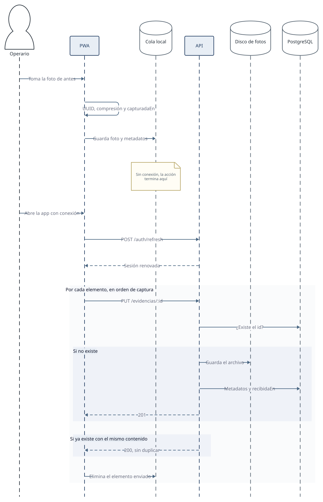

**Atributos que lo gobiernan:** tolerancia a fallos, precisión y comportamiento en el tiempo. **Impacto en la arquitectura:** obliga a un cliente con almacenamiento y cola propios, a un contrato con escrituras idempotentes y a renovar la sesión antes de subir (notas 002, 005 y 006).

### E2. Registro de la jornada con horas capturadas sin conexión

| Campo                            | Descripción                                                                                                          |
| -------------------------------- | -------------------------------------------------------------------------------------------------------------------- |
| Stakeholder                      | Gerencia y supervisores                                                                                              |
| Descripción general              | El operario marca la entrada al centro y el inicio y el fin de cada actividad                                        |
| Lo que hace hoy o quisiera hacer | Hoy el horario se reporta de palabra; la gerencia quisiera un registro creíble                                       |
| Disponible al inicio             | Programación del día en el celular                                                                                   |
| Contexto de la operación         | Los registros pueden llegar horas después y fuera de orden                                                           |
| Cómo debe responder el sistema   | Guardar la hora capturada y la recibida sin corregirlas, y derivar el estado de la actividad de los hechos conocidos |
| Salidas                          | Control de horario por operario y estado de cada actividad                                                           |
| Quién usa la salida y para qué   | Supervisores y administrativos, para controlar el cumplimiento                                                       |

**Atributos:** precisión y tolerancia a fallos. **Impacto:** dos horas por evento, estado derivado en vez de almacenado y registros idempotentes por UUID (nota 005). Es lo que permite que el control de horario sea creíble aunque la red no lo sea.

### E3. Revisión del supervisor

| Campo                            | Descripción                                                                                      |
| -------------------------------- | ------------------------------------------------------------------------------------------------ |
| Stakeholder                      | Supervisores                                                                                     |
| Descripción general              | El supervisor abre las actividades con evidencia sin revisar, mira las fotos y aprueba o rechaza |
| Lo que hace hoy o quisiera hacer | Hoy revisa en persona sin dejar constancia; quisiera registrar su decisión en sitio              |
| Disponible al inicio             | Al menos una evidencia sincronizada en la actividad                                              |
| Contexto de la operación         | En el conjunto, desde una tablet o un teléfono                                                   |
| Cómo debe responder el sistema   | Mostrar las fotos rápido y registrar la decisión; un rechazo exige observación                   |
| Salidas                          | Actividad aprobada o rechazada, con autor, hora y observación                                    |
| Quién usa la salida y para qué   | Gerencia y administrativos, para el seguimiento y como respaldo ante el conjunto                 |

Dos supervisores pueden abrir la misma actividad; la última decisión reemplaza a la anterior. Es aceptable porque la revisión es presencial y poco concurrente. **Atributos:** precisión, seguridad (solo el supervisor decide) y comportamiento en el tiempo. **Impacto:** la foto se sirve por una ruta autenticada con encabezados de caché inmutables, y la cola de revisión es una consulta derivada de los hechos, sin una tabla propia.

### E4. Publicación de la programación y envío del correo

| Campo                            | Descripción                                                                                           |
| -------------------------------- | ----------------------------------------------------------------------------------------------------- |
| Stakeholder                      | Administrativos y operarios                                                                           |
| Descripción general              | Al publicar la semana se envía un correo a cada operario con sus asignaciones, unos 150 mensajes      |
| Lo que hace hoy o quisiera hacer | Hoy la programación se comunica por mensajes sueltos; quisieran publicar una vez y que llegue a todos |
| Disponible al inicio             | Programación en borrador con sus asignaciones                                                         |
| Contexto de la operación         | Una vez por semana, antes del lunes                                                                   |
| Cómo debe responder el sistema   | Publicar de inmediato; el correo es un efecto secundario que no bloquea ni hace fallar la publicación |
| Salidas                          | Programación publicada y un correo por operario                                                       |
| Quién usa la salida y para qué   | Los operarios, para saber dónde y qué trabajar cada día                                               |

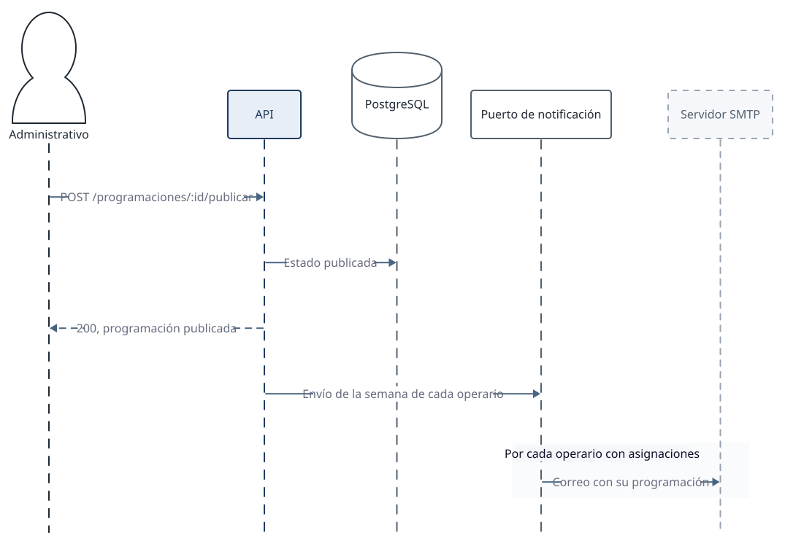

**Atributos:** cambiabilidad y capacidad de recuperación. **Impacto:** el envío va detrás de un puerto de notificación con un adaptador SMTP, de modo que en desarrollo lo recibe Mailpit y en producción un servidor real, y el dominio no sabe de correo. Un servidor SMTP caído no impide que la programación quede publicada.

## 5. Estilo arquitectónico

### Decisión

El estilo es un monolito modular con arquitectura hexagonal dentro de cada módulo (nota 001). El sistema se despliega como una sola aplicación organizada en seis módulos por capacidad de negocio, y cada módulo separa dominio, casos de uso, puertos y adaptadores. El cliente es una aplicación web progresiva que funciona primero sin conexión.

La razón es la escala real del problema: 200 usuarios, un servidor local y tres desarrolladores. Un monolito evita la red, los despliegues múltiples y la consistencia distribuida que cobrarían los microservicios sin devolver nada a esta escala. La división en módulos con límites estrictos conserva lo que sí importa, que es poder razonar, probar y cambiar cada parte por separado. Y la arquitectura hexagonal aísla las reglas de negocio de las tres cosas que pueden cambiar: la base de datos, el almacenamiento de fotos y el correo.

### Vista general

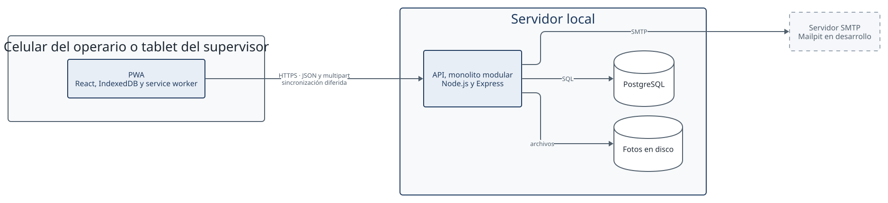

### Estructura de un módulo

La dependencia apunta siempre hacia el dominio. Los casos de uso conocen puertos, que son interfaces, y los adaptadores de infraestructura los implementan; el dominio no importa ninguna librería externa.

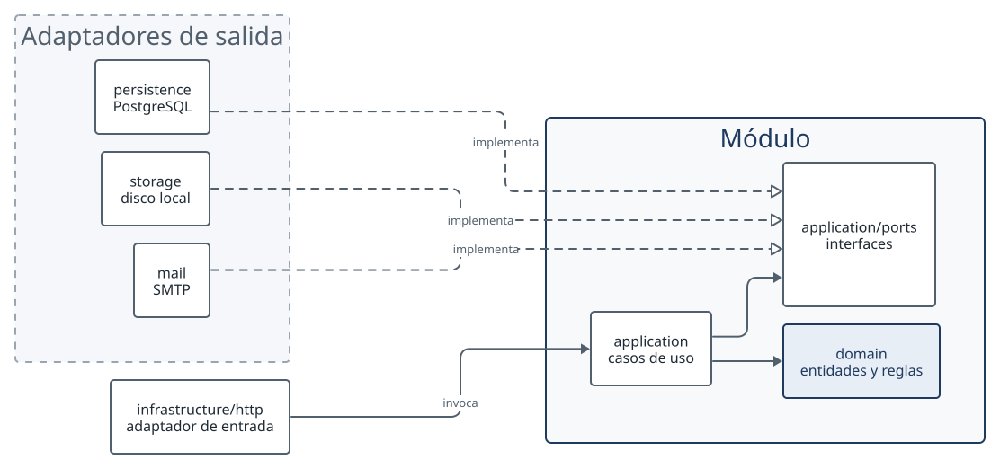

### Dependencias entre módulos

Los módulos forman un grafo sin ciclos. Cada flecha significa "usa la interfaz pública de". Cuando un módulo necesita algo de otro que ya depende de él, declara un puerto y la raíz de composición lo implementa. Es el caso de `HechosDeActividadPort`, que `programacion` declara para conocer el estado de sus actividades sin importar `jornada` ni `evidencias` (nota 010). El diagrama dibuja las aristas que existen hoy en el código: `jornada` y `evidencias` usan la interfaz pública de `programacion`, y `seguimiento` usa la de `jornada` y la de `programacion`. La nota 010 prevé además que `seguimiento` dependa de `evidencias`; el código no lo hace, porque los hechos de las evidencias le llegan a través de `HechosDeActividadPort`. `identidad` y `personal` no importan a ningún módulo y ningún módulo los importa: los datos de usuarios llegan a los demás como funciones que entrega la raíz de composición.

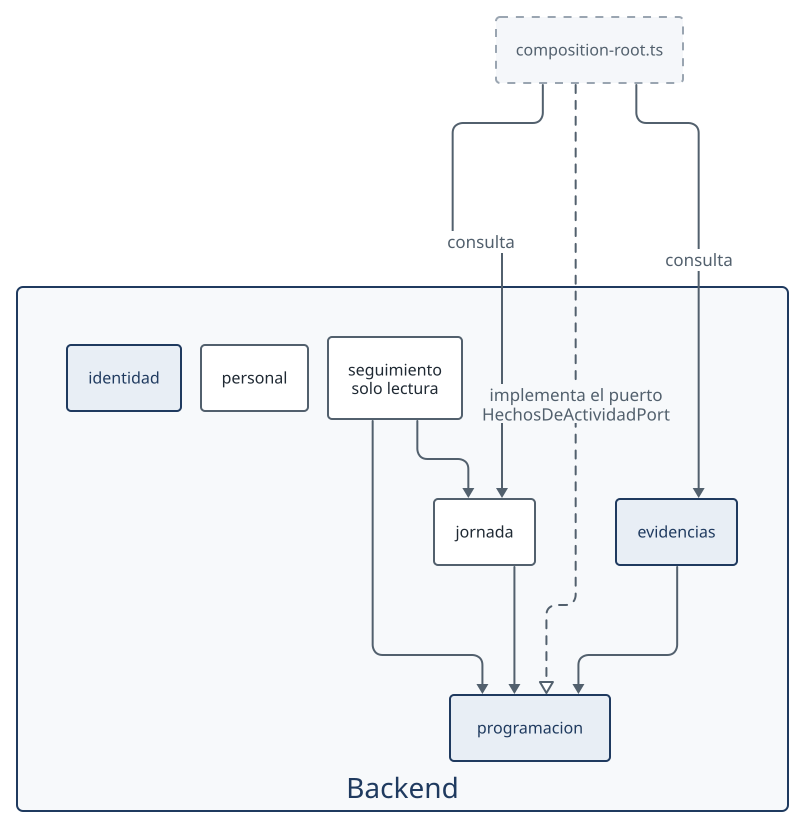

### Principios aplicados

El curso agrupa los principios de diseño en SOLID y en las prácticas de código limpio (Clean Code). La tabla muestra dónde se aplica cada uno, para que el código se pueda defender contra este documento.

| Principio                                | Cómo se aplica                                                                                                                                                                                                                                                                                            | Dónde se ve                                                                                                                                                                                                                                       |
| ---------------------------------------- | --------------------------------------------------------------------------------------------------------------------------------------------------------------------------------------------------------------------------------------------------------------------------------------------------------- | ------------------------------------------------------------------------------------------------------------------------------------------------------------------------------------------------------------------------------------------------- |
| Responsabilidad única (S)                | Cada módulo agrupa una capacidad de negocio y cada caso de uso es un archivo con una sola tarea. Los adaptadores solo traducen entre el exterior y el dominio.                                                                                                                                            | `backend/src/modules/evidencias/application/subir-evidencia.use-case.ts:36` y `backend/src/modules/jornada/application/registrar-jornada.use-case.ts:21`                                                                                          |
| Abierto y cerrado (O)                    | `SubirEvidenciaUseCase` solo conoce el puerto `AlmacenamientoEvidenciasPort`, así que sirve con cualquiera de sus adaptadores sin modificarlo: hoy existen `DiscoAlmacenamientoEvidencias` y `InMemoryAlmacenamientoEvidencias`. Un almacenamiento en la nube sería un tercero; no existe hoy (nota 007). | `backend/src/modules/evidencias/application/ports/almacenamiento-evidencias.port.ts:1`, `.../infrastructure/storage/disco-almacenamiento-evidencias.ts:5` y `.../in-memory-almacenamiento-evidencias.ts:3`                                        |
| Sustitución de Liskov (L)                | El repositorio en memoria y el de PostgreSQL implementan la misma interfaz, y el compilador verifica que cualquiera sirva donde se pide el puerto. Las dos implementaciones se prueban en suites distintas: la de memoria junto con los casos de uso y la de PostgreSQL contra la base real.              | `backend/src/modules/identidad/application/ports/sesion-repository.port.ts:3`, `.../persistence/pg-sesion.repository.ts:5` y `.../in-memory-sesion.repository.ts:4`; pruebas en `identidad.test.ts:20` y `backend/src/adaptadores-pg.test.ts:103` |
| Segregación de interfaces (I)            | Los puertos son pequeños y los declara quien los usa. `programacion` pide solo los hechos que necesita para derivar estados, no todo `jornada` ni todo `evidencias`.                                                                                                                                      | `backend/src/modules/programacion/application/ports/hechos-de-actividad.port.ts:3`; implementado en `backend/src/composition-root.ts:131`; nota 010                                                                                               |
| Inversión de dependencias (D)            | Los casos de uso dependen de interfaces y no de PostgreSQL, del disco ni de SMTP. Las implementaciones se conectan en un único punto.                                                                                                                                                                     | `backend/src/modules/evidencias/application/subir-evidencia.use-case.ts:37` (el constructor recibe puertos) y `backend/src/composition-root.ts:87`                                                                                                |
| Nombres con intención                    | El código usa el vocabulario del negocio definido en el glosario: `Actividad`, `Evidencia`, `RegistroJornada`. El operario no es un tipo propio: es un `Usuario` con rol `operario`.                                                                                                                      | `shared/src/programacion.ts:29`, `shared/src/evidencias.ts:19`, `shared/src/jornada.ts:46`, `shared/src/usuarios.ts:4`; Anexo B                                                                                                                   |
| Funciones pequeñas y sin efectos ocultos | El estado de una actividad lo calcula una función pura a partir de los hechos; registrar un hecho y consultar un estado son operaciones separadas.                                                                                                                                                        | `derivarEstado` en `backend/src/modules/programacion/domain/estado-actividad.ts:23`                                                                                                                                                               |
| Manejo explícito de errores              | Los errores de dominio tienen tipo propio y se traducen a códigos del contrato (`no_encontrado`, `conflicto`, `validacion`) en el borde HTTP, en vez de excepciones genéricas o valores nulos.                                                                                                            | `backend/src/modules/evidencias/domain/errores.ts:10`, `responderError` en `backend/src/infrastructure/http/validation.ts:17` y `docs/contrato-api.md`                                                                                            |
| No repetirse (DRY)                       | Cada tipo de la API se declara una sola vez, en `shared/`, y lo usan el backend y el cliente.                                                                                                                                                                                                             | `shared/src/index.ts:1`; nota 004                                                                                                                                                                                                                 |
| Simplicidad (KISS y YAGNI)               | Se demuestra por lo que no hay: sin ORM (los repositorios usan `pg` y SQL directo) y sin contenedor de inyección (los puertos se conectan a mano en una sola función). Un puerto existe solo donde hay un límite real con lo externo.                                                                     | `backend/package.json` (dependencias) y `backend/src/composition-root.ts:87`; `AGENTS.md`                                                                                                                                                         |
| Pruebas limpias                          | Dominio y casos de uso se prueban rápido y sin infraestructura; los adaptadores contra una base real, nunca con imitaciones de ella.                                                                                                                                                                      | `backend/src/modules/evidencias/evidencias.test.ts:29` (repositorios en memoria) y `backend/src/adaptadores-pg.test.ts:27` (PostgreSQL)                                                                                                           |

Dos principios estructurales completan los anteriores: alta cohesión, porque cada módulo es dueño de sus tablas y de sus reglas, y bajo acoplamiento, porque los módulos solo se comunican por su `index.ts` público y sin ciclos. `backend/src/arquitectura.test.ts` vigila dos reglas: que ningún módulo importe archivos internos de otro (línea 19) y que `composition-root.ts` no contenga SQL (línea 44). No comprueba la ausencia de ciclos ni que un repositorio lea solo sus tablas.

### Alternativas descartadas

| Alternativa                           | Por qué no                                                                                                                                                                  |
| ------------------------------------- | --------------------------------------------------------------------------------------------------------------------------------------------------------------------------- |
| Microservicios                        | Resuelven escala y equipos independientes que aquí no existen, y cobran red, despliegues y consistencia entre bases. Con tres personas y una máquina local no aportan nada. |
| Arquitectura por capas clásica        | La dependencia apunta a la base de datos, así que probar una regla exige una base, y los módulos terminan acoplados por las tablas.                                         |
| MVC                                   | Organiza la presentación, no el sistema; no dice dónde van las reglas de negocio ni dónde están los límites con lo externo.                                                 |
| Cliente-servidor con cliente en línea | Es el estilo del ejemplo del curso, pero exige conexión durante la operación, que es justo lo que los operarios no tienen.                                                  |

### Cliente

El cliente es una PWA que funciona primero sin conexión. Todas las acciones del operario se completan contra el almacenamiento local, y un servicio de sincronización aparte vacía una cola hacia la API. Usa los tipos y esquemas de `@plomada/shared` para hablar con el servidor, así el contrato es el mismo en ambos lados.

## 6. Diagrama de componentes

El backend es un monolito modular con arquitectura hexagonal en seis módulos (nota 001). La raíz de composición (`backend/src/composition-root.ts`) es el único lugar donde se instancian los adaptadores concretos y se inyectan en los casos de uso. No contiene SQL, y `backend/src/arquitectura.test.ts` lo comprueba.

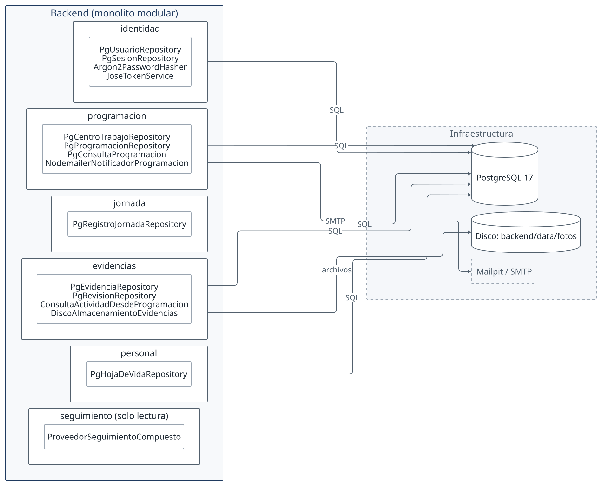

Cada módulo se usa solo por su `index.ts`:

- **`identidad`**: inicio de sesión, renovación de la sesión, usuarios autenticados y alta y listado de usuarios. Puertos `UsuarioRepositoryPort`, `SesionRepositoryPort`, `PasswordHasherPort` y `TokenServicePort`, con los adaptadores `PgUsuarioRepository`, `PgSesionRepository`, `Argon2PasswordHasher` y `JoseTokenService`.
- **`programacion`**: centros de trabajo, programaciones semanales, publicación con envío de correo y programación del operario (`ObtenerMiProgramacionUseCase`); exporta la función pura `derivarEstado`. Puertos `CentroTrabajoRepositoryPort`, `ProgramacionRepositoryPort` y `NotificadorProgramacionPort` (adaptador `NodemailerNotificadorProgramacion`); declara además `ConsultaProgramacionPort` (adaptador `PgConsultaProgramacion`) y `HechosDeActividadPort` para los demás módulos.
- **`jornada`**: registro de marcas de horario con UUID del cliente (`RegistrarJornadaUseCase`) y su consulta (`ListarRegistrosJornadaUseCase`). Puerto `RegistroJornadaRepositoryPort`; usa `ConsultaProgramacionPort` para comprobar el centro y la actividad.
- **`evidencias`**: subida de fotos con UUID del cliente (`SubirEvidenciaUseCase`), descarga de la foto (`ObtenerFotoEvidenciaUseCase`), cola de actividades del supervisor y revisión (`RevisarActividadUseCase`). Puertos `EvidenciaRepositoryPort`, `RevisionRepositoryPort`, `AlmacenamientoEvidenciasPort` (adaptador `DiscoAlmacenamientoEvidencias`) y `ConsultaActividadPort` (adaptador `ConsultaActividadDesdeProgramacion`).
- **`personal`**: hojas de vida de los operarios (`ObtenerHojaDeVidaUseCase`, `GuardarHojaDeVidaUseCase`). Puerto `HojaDeVidaRepositoryPort`, adaptador `PgHojaDeVidaRepository`.
- **`seguimiento`**: solo lectura. `ObtenerSeguimientoDiaUseCase` arma el día con `ProveedorSeguimientoCompuesto`, que usa `ConsultaProgramacionPort`, `HechosDeActividadPort` y el listado de `jornada`.

## 7. Diagrama entidad relación

El modelo relacional refleja los límites de cada módulo con claves foráneas por identificador (UUID). Cada repositorio lee y escribe solo las tablas de su módulo, y la raíz de composición no contiene SQL (`backend/src/arquitectura.test.ts`).

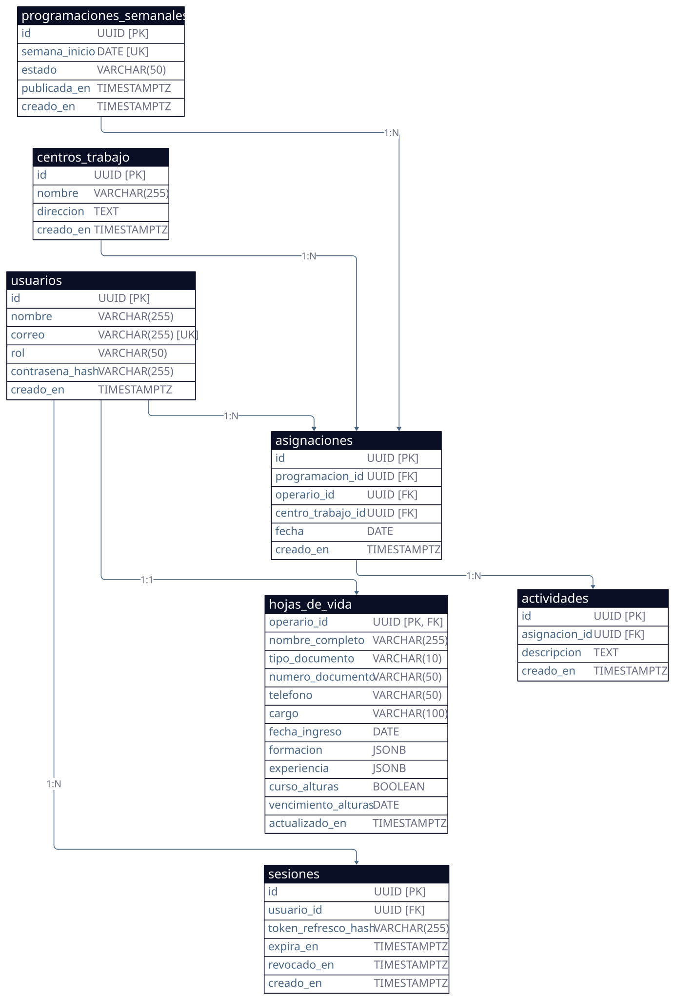

Propiedades del modelo:

- **Inmutabilidad de los hechos**: `registros_jornada` y `evidencias` guardan lo que capturan los operarios. Ninguna consulta del código hace `UPDATE` ni `DELETE` sobre ellas: las inserciones usan `ON CONFLICT (id) DO NOTHING` y `evidencias.actividad_id` es `ON DELETE RESTRICT`. Es una garantía de la aplicación, no de la base, que no impide modificar esas filas a quien tenga acceso directo. La semilla, que no corre en producción, las vacía con `TRUNCATE`.
- **Dos horas por hecho**: `capturado_en` y `recibido_en` en `registros_jornada`, y `capturada_en` y `recibida_en` en `evidencias`. La primera es la del dispositivo y la segunda la del servidor.
- **Estado derivado**: la tabla `actividades` no tiene columna de estado. El estado (`pendiente`, `en_curso`, `finalizada`, `aprobada`, `rechazada`) lo calcula la función pura `derivarEstado` a partir de las evidencias, las marcas de inicio y fin y la revisión.
- **Una decisión por actividad**: la clave primaria de `revisiones` es `actividad_id`, de modo que cada actividad admite una sola revisión. Que un rechazo traiga observación lo impone el esquema zod `RevisionSolicitud` (`shared/src/evidencias.ts:40`), no la tabla, cuya columna `observacion` admite nulos.
- **Fotos fuera de la base**: `evidencias` guarda los metadatos y la ruta relativa en `foto_ruta`. Los bytes quedan en disco, detrás de `AlmacenamientoEvidenciasPort`.

## 8. Justificación de la base de datos

Se elige **PostgreSQL 17**. La alternativa no relacional que se evaluó es una base documental como MongoDB, que es la que un equipo con JavaScript consideraría primero. La comparación se hace sobre los cuatro puntos que pesan en Plomada:

| Criterio                 | PostgreSQL                                                                                                                                                                                    | Base documental (MongoDB)                                                                                                                                                                  |
| ------------------------ | --------------------------------------------------------------------------------------------------------------------------------------------------------------------------------------------- | ------------------------------------------------------------------------------------------------------------------------------------------------------------------------------------------ |
| Relaciones               | Las entidades se relacionan por clave foránea: usuario, asignación, actividad, evidencia y revisión forman una cadena. Una consulta las une sin duplicar datos.                               | Se modela anidando o duplicando. Una actividad con sus evidencias cabe en un documento, pero el supervisor y el operario también las consultan por separado, y lo anidado se desincroniza. |
| Integridad               | El motor impide una evidencia sin actividad, una revisión duplicada por actividad o un rol inválido (`FOREIGN KEY`, `PRIMARY KEY`, `CHECK`). Las pruebas de adaptadores lo verifican.         | La integridad referencial pasa a la aplicación; un error de código deja datos huérfanos sin que nadie lo note.                                                                             |
| Consultas del supervisor | La cola de revisión cruza actividad, asignación, centro, operario y conteo de evidencias en una sola consulta con `JOIN` e índices sobre las claves. El estado derivado necesita esos cruces. | Los cruces entre colecciones se hacen con `$lookup` o en la aplicación, con menos ayuda del planificador.                                                                                  |
| Transacciones            | Un registro y su efecto se escriben de forma atómica, y `INSERT ... ON CONFLICT DO NOTHING` da la idempotencia por UUID que exige la nota 005 en una sola sentencia.                          | Las transacciones multidocumento existen, pero el modelo está pensado para evitarlas; la idempotencia se resuelve con índices únicos y cuidado.                                            |

Dos argumentos más inclinan la decisión. Los datos de Plomada son estructurados y estables: las columnas se conocen y cambian poco, así que la flexibilidad de esquema de un documento no se aprovecha. Y las hojas de vida del módulo `personal` sí tienen forma variable (formación y experiencia); se guardan en una columna `JSONB`, de modo que el motor relacional absorbe ese caso sin sumar un segundo motor.

Las fotos no van en la base: se guardan en disco detrás del puerto `AlmacenamientoEvidencias` y en PostgreSQL solo quedan los metadatos, para no inflar la base ni sus respaldos (nota 007).

**Conclusión.** El sistema es esencialmente relacional y exige integridad y consultas cruzadas, y eso es lo que PostgreSQL resuelve mejor. El costo es esquema rígido y migraciones SQL, que con tres integrantes y un modelo estable es aceptable (nota 012).

## 9. Diagrama de despliegue

No hay despliegue en un servidor: el taller permite un despliegue local y no hay recursos para otro. Todo corre en un portátil, y el diagrama describe ese entorno.

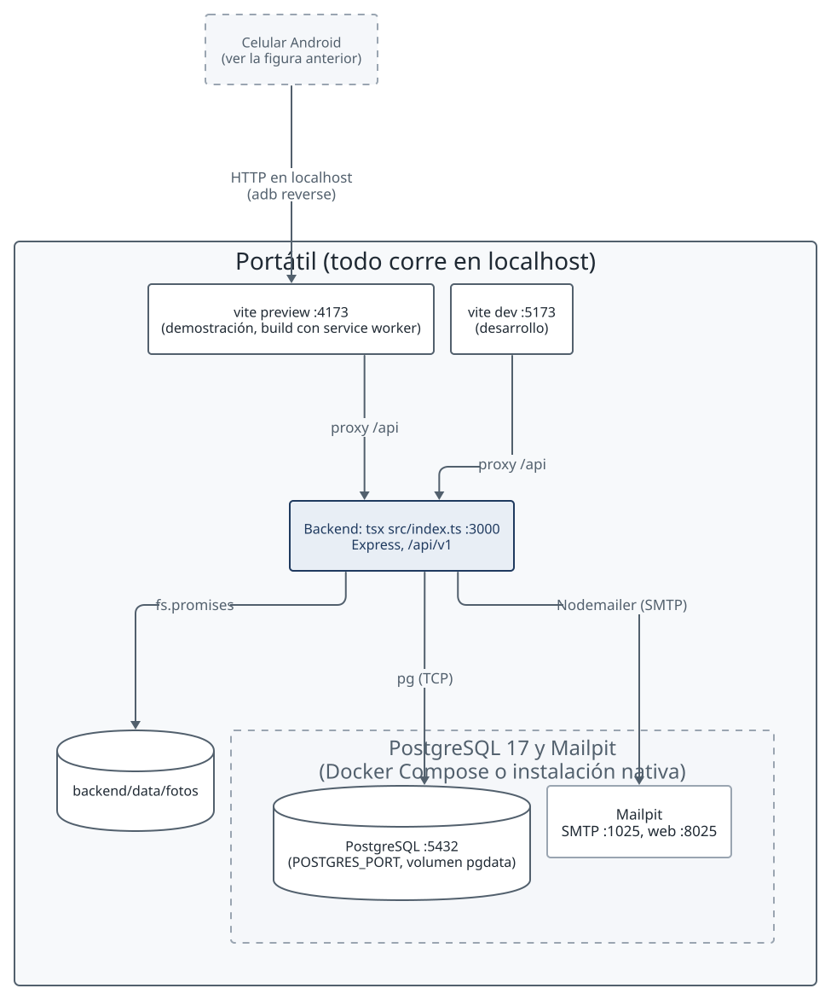

Aspectos del despliegue:

- **Infraestructura**: hay dos formas de levantarla. Con Docker Compose (`docker compose up -d`) arrancan PostgreSQL 17 (`postgres:17-alpine`) y Mailpit. Sin Docker se usa un PostgreSQL 17 nativo y el ejecutable de Mailpit, como describe la sección "Entorno sin Docker" del README.
- **Procesos**: el backend corre con `tsx` en el puerto 3000. La PWA se sirve con `vite preview` en el 4173 para la demostración, porque el service worker solo existe en el build, y con `vite dev` en el 5173 para desarrollo. Los dos reenvían `/api` al backend (`frontend/vite.config.ts`), así que el navegador usa un solo origen.
- **Datos**: PostgreSQL escucha en el 5432, configurable con `POSTGRES_PORT`, con el volumen `pgdata` y sin límite de memoria. Mailpit recibe SMTP en el 1025 y muestra su bandeja en el 8025. El backend guarda las fotos en `backend/data/fotos` (variable `FOTOS_DIR`).
- **Acceso**: todo va por HTTP en `localhost`, porque TLS queda fuera de v1 (ítem 1). El celular entra por `adb reverse` a `localhost`, que es un contexto seguro (`docs/demostracion.md`). Por IP en HTTP no hay service worker ni almacenamiento persistente, y la prueba C-7 se hizo así (`docs/pruebas-celular.md`).

### Inventario de recursos

| Recurso             | Tipo                    | Cantidad | Especificación / Ubicación                                                                                 | Propósito                                             |
| ------------------- | ----------------------- | -------- | ---------------------------------------------------------------------------------------------------------- | ----------------------------------------------------- |
| Portátil            | Equipo                  | 1        | Ejecuta el backend, los servidores de Vite, PostgreSQL y Mailpit                                           | Entorno local de desarrollo y de demostración         |
| Node.js             | Entorno de ejecución    | 1        | Versión 22 o superior (`engines` de `package.json`)                                                        | Backend con `tsx` y herramientas del cliente          |
| pnpm                | Gestor de paquetes      | 1        | 10.28.0 (`packageManager` de `package.json`)                                                               | Instalación y scripts del workspace                   |
| PostgreSQL          | Base de datos           | 1        | Versión 17: imagen `postgres:17-alpine` o instalación nativa. Puerto 5432, volumen `pgdata`                | Datos de usuarios, programación, jornada y evidencias |
| Mailpit             | Servidor SMTP de prueba | 1        | Imagen `axllent/mailpit` o ejecutable. SMTP en el 1025, web en el 8025                                     | Recibir los correos de publicación de la programación |
| Directorio de fotos | Disco                   | 1        | `backend/data/fotos`. La proyección de 1,1 GB al día es un supuesto de volumen del ítem 1, no una medición | Guardar las fotos comprimidas de los operarios        |
| Celular Android     | Dispositivo             | 1        | El de la prueba C-7, con Chrome. Modelo y versión por confirmar (`docs/pruebas-celular.md`)                | Probar el cliente en un dispositivo real              |

## 10. Tecnologías

A continuación se confirma la selección tecnológica definitiva implementada en el proyecto:

| Capa                  | Tecnología                                    | Justificación y Estado                                                                                 |
| --------------------- | --------------------------------------------- | ------------------------------------------------------------------------------------------------------ |
| Lenguaje              | TypeScript 7 (modo estricto), Node.js 22      | Tipado estricto en todos los paquetes; módulos ECMAScript nativos.                                     |
| Gestor de paquetes    | pnpm 10 con workspaces y catálogos            | Lockfile determinista, sin duplicación de dependencias en disco.                                       |
| Contrato API          | zod 4 en `@plomada/shared`                    | Tipos inferidos y validación de esquemas idénticos en cliente y servidor.                              |
| Cliente Web / PWA     | React 19, Vite 8, Dexie.js, `vite-plugin-pwa` | PWA offline-first con IndexedDB tipado (ADR 011) y compresión Canvas.                                  |
| Servidor HTTP         | Express 5                                     | Monolito modular con middlewares y rutas REST en `/api/v1`.                                            |
| Seguridad / Tokens    | `@node-rs/argon2`, `jose`                     | Hash seguro argon2id para contraseñas; JWT para access tokens y hash para refresh tokens.              |
| Subida de archivos    | `multer`                                      | Manejo en memoria y almacenamiento en disco con límites de 1.5 MB.                                     |
| Base de datos         | PostgreSQL 17 con cliente `pg`                | Repositorios SQL puros con transacciones manuales; migraciones TypeScript.                             |
| Correo                | Nodemailer sobre SMTP (Mailpit en desarrollo) | Notificación asíncrona no bloqueante al publicar programación.                                         |
| Pruebas               | Vitest 5                                      | Pruebas unitarias de dominio con repositorios en memoria y pruebas de integración con PostgreSQL real. |
| Infraestructura local | Docker Compose                                | Contenedores estandarizados para base de datos y correo.                                               |
| Documentación         | Markdown, D2 y Playwright                     | Generación automatizada de diagramas vectoriales y documento imprimible.                               |

## 11. Decisiones críticas

Cada decisión crítica cuenta con una nota estructurada en `docs/decisiones/` (problema, opciones y selección justificada):

<!-- pdf:omitir -->

| Nota                                                      | Problema                                                                                      | Opción seleccionada                                                            |
| --------------------------------------------------------- | --------------------------------------------------------------------------------------------- | ------------------------------------------------------------------------------ |
| [001](decisiones/001-estilo-arquitectonico.md)            | Estilo para 200 usuarios, tres personas y despliegue local                                    | Monolito modular con arquitectura hexagonal                                    |
| [002](decisiones/002-cliente-sin-conexion.md)             | Operarios sin datos móviles ni internet garantizado                                           | PWA que funciona primero sin conexión                                          |
| [003](decisiones/003-stack-y-workspace.md)                | Organizar el código para tres personas sin desalinear backend y frontend                      | TypeScript, workspace de pnpm y paquete `shared`                               |
| [004](decisiones/004-contrato-como-codigo.md)             | Acordar el contrato antes de integrar                                                         | Esquemas zod compartidos y documento verificado por prueba                     |
| [005](decisiones/005-sincronizacion-y-tiempo.md)          | Reintentos sin duplicados y relojes no fiables                                                | `PUT` idempotente con UUID del cliente, dos horas por evento y estado derivado |
| [006](decisiones/006-autenticacion.md)                    | Sesión que sobrevive a horas sin conexión sin tokens de larga vida                            | Token de acceso de 15 minutos y refresh rotativo                               |
| [007](decisiones/007-fotos.md)                            | Transporte, almacenamiento y peso de las fotos                                                | Multipart, disco local detrás de un puerto y compresión en el cliente          |
| [008](decisiones/008-alcance-v1.md)                       | Alcance posible con tres personas y poco tiempo                                               | Recorrido vertical mínimo con prioridades P0 a P2                              |
| [009](decisiones/009-seguimiento-polling.md)              | "Tiempo real" limitado por la sincronización                                                  | Polling cada 10 a 15 segundos                                                  |
| [010](decisiones/010-dependencias-entre-modulos.md)       | Ciclo entre `programacion`, `evidencias` y `jornada`                                          | Grafo sin ciclos y puerto implementado en la raíz de composición               |
| [011](decisiones/011-almacenamiento-local-dexie.md)       | Almacenamiento local en el cliente PWA sin base64 y con transacciones atómicas                | Dexie.js sobre IndexedDB                                                       |
| [012](decisiones/012-migraciones-sql-propias.md)          | Migraciones del esquema sin dependencia adicional                                             | Archivos SQL numerados con un ejecutor propio                                  |
| [013](decisiones/013-panel-administracion.md)             | Panel web de administración construido fuera del alcance escrito en la nota 008               | Conservarlo como excepción aprobada y acotada                                  |
| [014](decisiones/014-autorizacion-por-rol-en-router.md)   | AGENTS.md pide autorizar en la capa de aplicación y el código lo hace en el router            | Aceptar el desvío, con la propiedad del recurso en aplicación                  |
| [015](decisiones/015-dominio-de-correo-de-operarios.md)   | El contrato fijaba `@plomada.local` para los operarios, un dominio sin entrega real de correo | Validar solo el formato; el dominio es política de cada despliegue             |
| [016](decisiones/016-dia-de-negocio-en-hora-de-bogota.md) | «Hoy», la semana y el día de un evento se calculaban en UTC y se corrían a las 19:00 locales  | Zona fija `America/Bogota` con un helper único; los instantes siguen en UTC    |

<!-- /pdf:omitir -->

<!-- pdf:incluir decisiones -->

## Anexo A. Método de priorización

Los atributos y su prioridad se obtuvieron con una versión reducida del taller de atributos de calidad (QAW) que usa el curso. No hubo una sesión con la empresa: el equipo aplicó los pasos usando el enunciado como voz de los stakeholders, y por eso las cifras del ítem 1 se presentan como supuestos.

1. **Presentación.** Se fijó el objetivo: descubrir los atributos de calidad que orientan la arquitectura antes de decidirla.
2. **Objetivos de negocio.** Son las metas del negocio del capítulo de contexto.
3. **Plan arquitectónico.** Se partió de una vista inicial con cliente, servidor, base de datos y correo, que es la vista general de la sección 5.
4. **Conductores arquitectónicos.** La operación sin conexión, la trazabilidad de la evidencia, la seguridad del acceso y los celulares de gama baja.
5. **Generación de escenarios.** Se leyó cada necesidad del enunciado desde cada stakeholder, lo que dio los escenarios funcionales del contexto.
6. **Consolidación.** Los escenarios se agruparon por característica y subcaracterística de ISO/IEC 9126.
7. **Priorización.** Cada atributo recibió una prioridad según cuánto daño hace incumplirlo y cuántas decisiones condiciona, que es la columna de prioridad de las propiedades sistémicas.
8. **Refinamiento.** Los atributos de prioridad alta se convirtieron en los escenarios EC-01 a EC-10, con una medida verificable, y se resumieron en el árbol de utilidades.

<!-- pdf:incluir glosario -->
