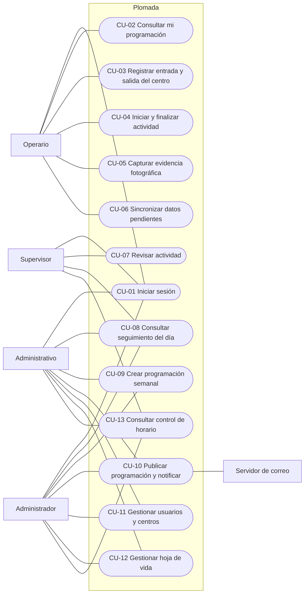
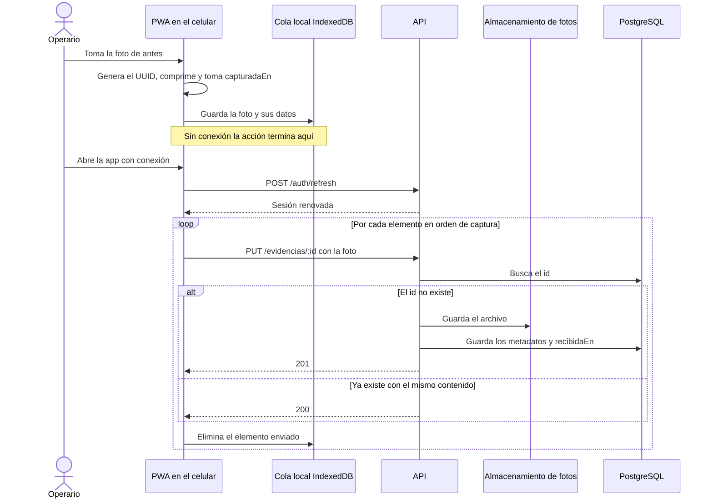
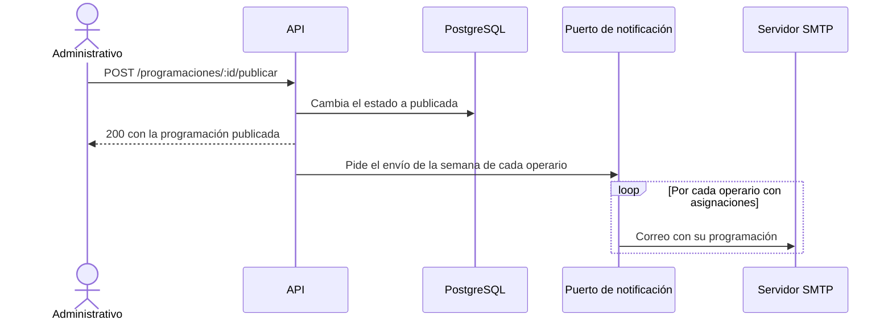
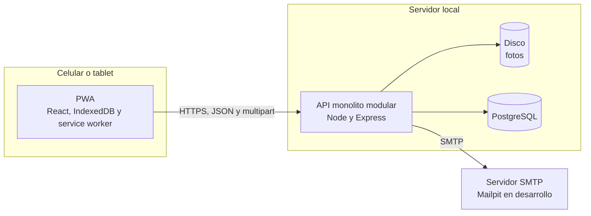
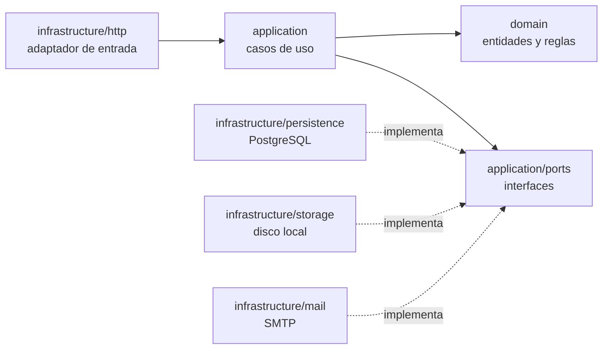
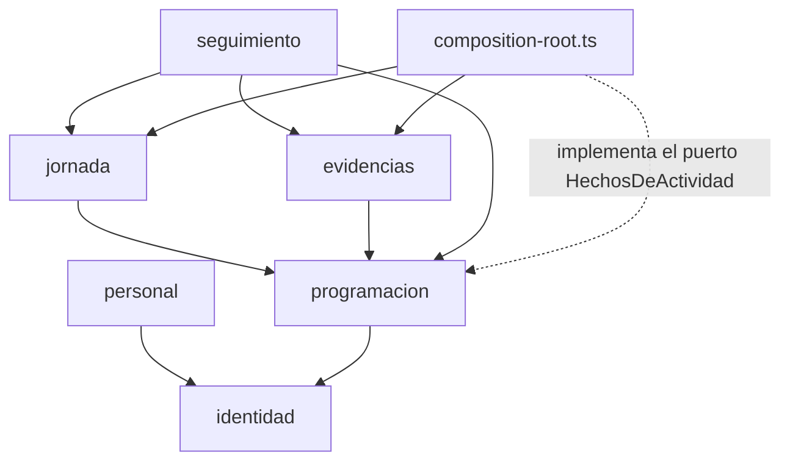

# Plomada: documento de arquitectura

Taller práctico de Ingeniería de Software Orientado a Objetos, Universidad Surcolombiana. Estado: borrador de A. Los ítems 6 a 9 están reservados para B y C, con el punto de partida que A les deja.

| Ítem | Contenido | Responsable | Estado |
|---|---|---|---|
| 1 | Atributos de calidad | A | Borrador |
| 2 | Limitaciones técnicas y de negocio | A | Borrador |
| 3 | Casos de uso | A | Borrador |
| 4 | Escenarios críticos | A | Borrador |
| 5 | Estilo arquitectónico | A | Borrador |
| 6 | Diagrama de componentes | B | Pendiente |
| 7 | Entidad relación | B | Pendiente |
| 8 | Justificación de la base de datos | B | Pendiente |
| 9 | Diagrama de despliegue | C | Pendiente |
| 10 | Tecnologías | A, con B y C | Borrador |
| 11 | Decisiones críticas | A integra | En curso |

## El problema en breve

Una empresa de mantenimiento locativo para conjuntos cerrados (piscinas, pintura, jardinería) programa cada semana, de lunes a viernes, a unos 150 operarios. Cada operario fotografía el antes, el durante y el después de cada actividad con su propio celular de gama baja o media, y registra la hora de entrada y salida del centro de trabajo y de inicio y fin de cada actividad. Un supervisor revisa el trabajo en sitio y registra su decisión. Los operarios no tienen datos móviles y el conjunto no garantiza internet. Hay además hojas de vida, seguimiento del día, control de horario y un correo semanal con la programación a cada operario. Los roles son un administrador, unos 20 administrativos, unos 30 supervisores y unos 150 operarios.

La restricción dominante es la falta de conexión, y casi todas las decisiones de este documento se explican por ella.

## 1. Atributos de calidad priorizados

### Supuestos de volumen

El enunciado no da cifras de uso, así que estos supuestos son del equipo y deben validarse con el cliente o el profesor. Sobre ellos se calculan los objetivos.

Se asumen unas 200 cuentas (1 administrador, 20 administrativos, 30 supervisores y 150 operarios), hasta 6 actividades por operario por día y 3 fotos por actividad. Eso son 150 × 6 × 3 = 2,700 fotos por día. Con fotos de unos 400 KB tras la compresión, son alrededor de 1.1 GB por día, 5.4 GB por semana y unos 280 GB por año. Si el 80% de los operarios sincroniza en la media hora posterior al cierre de la jornada, son unas 1.2 fotos por segundo en promedio, y se diseña para sostener 5 por segundo, cuatro veces ese promedio. Los 30 supervisores consultando cada 12 segundos suman unas 2.5 peticiones por segundo.

### Atributos y objetivos

| Prioridad | Atributo | Objetivo medible | Cómo lo logra la arquitectura |
|---|---|---|---|
| 1 | Tolerancia a la desconexión | El operario trabaja al menos 48 horas sin conexión sin perder datos. Cero fotos perdidas y cero duplicadas tras reintentos. | PWA que funciona primero sin conexión, cola local en IndexedDB y escrituras `PUT` idempotentes (notas 002 y 005) |
| 2 | Integridad y trazabilidad | Toda evidencia es inmutable. Cada hecho guarda la hora capturada y la recibida. Ninguna revisión se pierde. | UUID del cliente como clave, sin reemplazo de fotos, dos horas por evento, estado derivado de hechos (nota 005) |
| 3 | Seguridad | Autenticación con correo institucional y contraseña con argon2id. Token de acceso de 15 minutos y refresh de 7 días rotativo. Cuatro roles aplicados en la capa de aplicación. TLS 1.2 o superior en producción. Las fotos solo se sirven con token. | Módulo `identidad`, autorización en casos de uso y no en el router (nota 006) |
| 4 | Tiempo de respuesta | En el servidor, p95 de 500 ms para consultas y registros, 1 s para el inicio de sesión (el hash es lento a propósito) y 2 s para procesar una foto de 400 KB. En el cliente, toda acción del operario responde localmente en menos de 100 ms. | Acciones contra el almacenamiento local y sincronización separada de la interacción |
| 5 | Capacidad | 200 cuentas, 150 operarios sincronizando en 30 minutos, 5 fotos por segundo sostenidas, y un crecimiento al doble sin cambiar la arquitectura. | Monolito que escala verticalmente, con carga muy por debajo de sus límites |
| 6 | Modificabilidad | Cambiar el disco de fotos por un servicio en la nube, o el correo de pruebas por uno real, sin tocar el dominio. Dominio y casos de uso probados sin base de datos. | Puertos y adaptadores, módulos con interfaz pública (notas 001, 007 y 010) |
| 7 | Usabilidad en gama baja | Aplicación instalable, con una carga inicial de 500 KB comprimidos como máximo, capaz de abrirse sin conexión tras la primera visita. Captura con la cámara nativa del teléfono. | PWA sin librerías de interfaz pesadas y compresión en el cliente |
| 8 | Tiempo en línea del servidor | 99.5% en horario laboral (lunes a viernes, 6:00 a 18:00), unos 1.3 horas de caída al mes. | El cliente tolera caídas del servidor, así que la disponibilidad que percibe el operario es mayor que la del servidor |

La disponibilidad del servidor queda en el último lugar a propósito. Como el operario trabaja y acumula en su celular aunque el servidor esté caído, una caída corta retrasa la sincronización y no detiene a nadie. Eso permite un despliegue local de un solo servidor sin redundancia, que es lo que el taller admite.

## 2. Limitaciones técnicas y de negocio

### Técnicas

| Limitación | Origen | Efecto en el diseño |
|---|---|---|
| Sin datos móviles ni internet garantizado en el sitio | Enunciado | Cliente que funciona primero sin conexión (nota 002) |
| Celulares personales de gama baja o media, heterogéneos y sin gestión de la empresa | Enunciado | PWA en lugar de aplicación nativa, compresión de fotos, captura con la cámara nativa |
| El service worker y `crypto.randomUUID()` requieren HTTPS o `localhost` | Navegador | El demo corre en `localhost` con emulación de móvil. Probar en un celular real exige HTTPS local |
| Background Sync no existe en iOS | Plataforma | La sincronización se dispara al abrir la aplicación, al volver la conexión y con un botón manual |
| El reloj del celular no es fiable | Dispositivo | Se guardan la hora capturada y la recibida, sin corregir ninguna (nota 005) |
| Cuota de almacenamiento local limitada en gama baja | Dispositivo | Compresión a unos 400 KB y aviso al operario si la cola crece |
| Despliegue local en un solo servidor, sin alta disponibilidad | Taller | Monolito sin redundancia. La disponibilidad percibida viene de la tolerancia del cliente |
| "Tiempo real" acotado por la sincronización de los celulares | Consecuencia del enunciado | Seguimiento casi en tiempo real por polling (nota 009) |
| Fotos sin cifrado a nivel de aplicación | Decisión | Se confía en el cifrado de disco del sistema operativo (nota 006) |

### De negocio

| Limitación | Efecto en el diseño |
|---|---|
| El supervisor revisa el trabajo en persona. El sistema registra su decisión y no la sustituye. | La revisión es un registro del supervisor sobre la evidencia, no una validación automática |
| Cada operario necesita un correo institucional, que crea la empresa | El correo identifica al usuario y es el destino de la programación semanal |
| La programación es semanal, de lunes a viernes, hecha por el administrador | Una programación por semana, sin edición tras publicar (nota 008) |
| Cada actividad tiene tres fotos: antes, durante y después | Tres tipos de evidencia, más de una foto por tipo permitida |
| La empresa no suministra dispositivos a los operarios y puede dar tablets a los supervisores | La vista del supervisor debe funcionar también en un teléfono |
| Tiempo y personas del taller limitados | Alcance mínimo vertical con prioridades P0 a P2 (nota 008) |

## 3. Casos de uso

El diagrama usa la sintaxis de diagramas de flujo de Mermaid con una notación cercana a UML: los actores a la izquierda, los casos de uso dentro del sistema y una línea por cada participación. Mermaid no tiene un tipo nativo de diagrama de casos de uso.

| Caso de uso | Actor principal | Módulo | Prioridad |
|---|---|---|---|
| CU-01 Iniciar sesión con correo institucional y renovar la sesión | Todos | `identidad` | P0 |
| CU-02 Consultar la programación de la semana, también sin conexión | Operario | `programacion` | P0 |
| CU-03 Registrar entrada y salida del centro de trabajo | Operario | `jornada` | P1 |
| CU-04 Registrar inicio y fin de una actividad | Operario | `jornada` | P1 |
| CU-05 Tomar la foto de antes, durante y después de una actividad | Operario | `evidencias` | P0 |
| CU-06 Sincronizar con el servidor lo capturado sin conexión | Operario | `evidencias` y `jornada` | P0 |
| CU-07 Revisar una actividad y aprobarla o rechazarla con observación | Supervisor | `evidencias` | P0 |
| CU-08 Consultar el seguimiento del día | Supervisor, administrativo, administrador | `seguimiento` | P2 |
| CU-09 Crear la programación semanal | Administrativo, administrador | `programacion` | P0 |
| CU-10 Publicar la programación y enviar el correo a cada operario | Administrativo, administrador | `programacion` | P0 |
| CU-11 Gestionar usuarios y centros de trabajo | Administrador, administrativo | `identidad` y `programacion` | P1 |
| CU-12 Gestionar la hoja de vida de un operario | Administrativo, administrador | `personal` | P2 |
| CU-13 Consultar el control de horario de entrada y salida | Supervisor, administrativo, administrador | `jornada` | P1 |

## 4. Escenarios críticos

Se identifican cuatro flujos con mayor impacto en la arquitectura. Cada uno obliga a una decisión que de otro modo sería más barata, y por eso son los que el diseño defiende.

### E1. Sincronización de evidencias capturadas sin conexión

Un operario toma las tres fotos de una actividad en un sótano sin señal, y a media tarde, ya con conexión, la aplicación las envía. La captura termina contra el almacenamiento local, sin red. La sincronización renueva la sesión y drena la cola de a un elemento, en orden de captura. Si un corte interrumpe un envío, el cliente no sabe si el servidor lo recibió y simplemente lo reintenta: la segunda vez el servidor responde 200 con la foto ya guardada y no crea otra.

Atributos que lo gobiernan: tolerancia a la desconexión, integridad y capacidad. Impacto en la arquitectura: obliga a un cliente con almacenamiento y cola propios, a un contrato con escrituras idempotentes y a renovar la sesión antes de subir (notas 002, 005 y 006).

### E2. Registro de la jornada con horas capturadas sin conexión

El operario marca la entrada al centro y el inicio y fin de cada actividad. Esos hechos se registran con la hora del celular en el instante en que ocurren, y pueden llegar al servidor horas después y fuera de orden. El servidor guarda la hora capturada y la de recepción sin corregir ninguna, y deriva el estado de la actividad a partir de los hechos conocidos, de modo que el orden de llegada no altera el resultado.

Atributos: integridad y trazabilidad. Impacto: dos horas por evento, estado derivado y no almacenado, y registros idempotentes por UUID (nota 005). Es lo que permite que el control de horario sea creíble aunque la red no lo sea.

### E3. Revisión del supervisor

Un supervisor revisa el trabajo en el sitio y, desde su tablet o su teléfono, abre la cola de actividades con evidencia y sin revisión, mira las fotos y aprueba o rechaza, con observación obligatoria al rechazar. Dos supervisores pueden abrir la misma actividad; la última decisión reemplaza a la anterior, lo cual es aceptable porque la revisión es presencial y poco concurrente. La decisión mueve el estado de la actividad a aprobada o rechazada.

Atributos: integridad, seguridad (solo el supervisor decide) y tiempo de respuesta. Impacto: la foto se sirve por una ruta autenticada con encabezados de caché inmutables, y la cola de revisión es una consulta derivada de los hechos, sin una tabla propia.

### E4. Publicación de la programación y envío del correo

Al publicar la semana, el administrador dispara un correo a cada operario con sus asignaciones: unos 150 mensajes. El cambio de estado es lo que debe ser inmediato y fiable. El correo es un efecto secundario que no bloquea la respuesta ni la hace fallar, y un servidor SMTP caído no puede impedir que la programación quede publicada.

Atributos: modificabilidad y disponibilidad. Impacto: el envío va detrás de un puerto de notificación con un adaptador SMTP, de modo que en desarrollo lo recibe Mailpit y en producción uno real, y el dominio no sabe de correo.

## 5. Estilo arquitectónico

### Decisión

Monolito modular con arquitectura hexagonal dentro de cada módulo (nota 001). El sistema se despliega como una sola aplicación, organizada en seis módulos por capacidad de negocio, cada uno con dominio, casos de uso, puertos y adaptadores.

### Vista general

### Estructura de un módulo

La dependencia apunta siempre hacia el dominio. Los casos de uso conocen puertos, que son interfaces, y los adaptadores de infraestructura las implementan; el dominio no importa ninguna librería externa.

### Dependencias entre módulos

Los módulos forman un grafo sin ciclos. Cada flecha significa "importa la interfaz pública de". Cuando un módulo necesita algo de otro que ya depende de él, declara un puerto y la raíz de composición lo implementa, que es el caso de `HechosDeActividad` en `programacion` (nota 010).

### Principios aplicados

Los nombres siguen la terminología habitual del diseño orientado a objetos. Falta mapearlos a la terminología exacta del material de apoyo de la clase, tarea pendiente de A.

| Principio | Cómo se aplica | Dónde se ve |
|---|---|---|
| Separación de responsabilidades | Dominio, casos de uso y adaptadores en capas distintas dentro de cada módulo | Estructura `domain`, `application`, `infrastructure` |
| Alta cohesión | Cada módulo agrupa una capacidad de negocio completa | Seis módulos, cada uno dueño de sus tablas |
| Bajo acoplamiento | Los módulos se comunican solo por su interfaz pública y sin ciclos | Grafo de dependencias, nota 010 |
| Inversión de dependencias | Los casos de uso dependen de puertos, no de PostgreSQL, el disco ni SMTP | `application/ports` y `composition-root.ts` |
| Abierto y cerrado | Se agrega un adaptador nuevo, como almacenamiento en la nube, sin modificar dominio ni casos de uso | Puerto `AlmacenamientoEvidencias`, nota 007 |
| Sustitución | El repositorio en memoria y el de PostgreSQL son intercambiables porque implementan la misma interfaz, y el compilador lo verifica | Pruebas de dominio con repositorios en memoria |
| Ocultamiento de información | Un módulo expone un `index.ts` público y esconde todo lo demás | Regla de imports entre módulos |
| KISS y YAGNI | Un puerto existe solo donde hay un límite real con lo externo | Regla de AGENTS.md |

### Alternativas descartadas

| Alternativa | Por qué no |
|---|---|
| Microservicios | Resuelven escala y equipos independientes que aquí no existen, y cobran red, despliegues y consistencia entre bases. Con tres personas y una máquina local no compran nada. |
| Arquitectura por capas clásica | La dependencia apunta a la base de datos, así que probar una regla exige una base, y los módulos terminan acoplados por las tablas. |
| MVC | Organiza la presentación, no el sistema, y no dice dónde van las reglas de negocio ni los límites con lo externo. |

### Cliente

El cliente es una PWA que funciona primero sin conexión. Todas las acciones del operario se completan contra el almacenamiento local, y un servicio de sincronización aparte drena una cola hacia la API. Usa los tipos y esquemas de `@plomada/shared` para hablar con el servidor, de modo que el contrato es el mismo en ambos lados. C detalla su estructura interna en el ítem 9 y en el de tecnologías.

## 6. Diagrama de componentes

Pendiente de B. El diagrama de componentes del backend en Mermaid, con los seis módulos, sus puertos y los adaptadores concretos (PostgreSQL, disco, SMTP). Debe respetar el grafo de dependencias de la sección 5 y mostrar la raíz de composición como el único lugar donde se conectan puertos y adaptadores.

## 7. Diagrama entidad relación

Pendiente de B. Entidad relación en Mermaid (`erDiagram`) de las tablas del backend, a partir del vocabulario de `docs/glosario.md`. Cada módulo es dueño de sus tablas y las referencias entre módulos son claves foráneas por identificador. El estado de una actividad no es una columna: se deriva de los hechos (nota 005).

## 8. Justificación de la base de datos

Pendiente de B. Justificación de PostgreSQL frente a, al menos, una alternativa no relacional. Punto de partida: los datos están fuertemente relacionados (usuario, asignación, actividad, evidencia, revisión), las consultas del supervisor combinan varias de esas entidades y la integridad referencial importa para la trazabilidad (nota 003).

## 9. Diagrama de despliegue

Pendiente de C. Diagrama de despliegue en Mermaid del escenario local: el navegador del celular o del portátil con la PWA, el proceso del backend, PostgreSQL y Mailpit en contenedores, y el directorio de fotos en disco. Restricciones que debe reflejar: el service worker exige HTTPS o `localhost`, y la API se sirve bajo `/api/v1` en el mismo origen que la PWA gracias al proxy de desarrollo.

## 10. Tecnologías

Las filas marcadas "por defecto" son las decisiones abiertas de B y C (ver `docs/decisiones/README.md`). Se confirman o se reemplazan cuando se tomen.

| Capa | Tecnología | Estado |
|---|---|---|
| Lenguaje | TypeScript 7 en modo estricto, Node.js 22 o superior | Decidido (nota 003) |
| Gestor de paquetes | pnpm 10 con workspaces y catálogo de versiones | Decidido (nota 003) |
| Contrato | zod 4 en `@plomada/shared` | Decidido (nota 004) |
| Cliente | React 19, Vite 8, `react-router`, `idb`, `vite-plugin-pwa` | React y Vite decididos, el resto por defecto |
| Servidor | Express 5, `jose`, `@node-rs/argon2`, `multer`, `pino` | Express decidido, el resto por defecto |
| Base de datos | PostgreSQL 17 con `pg` y `node-pg-migrate` | PostgreSQL decidido, el resto por defecto |
| Fotos | Disco local detrás del puerto `AlmacenamientoEvidencias` | Decidido (nota 007) |
| Correo | SMTP con Nodemailer, Mailpit en desarrollo | Decidido el uso de SMTP, la librería por defecto |
| Pruebas | Vitest 5, `msw` para datos simulados en el cliente | Vitest decidido, `msw` por defecto |
| Infraestructura local | Docker Compose para PostgreSQL y Mailpit | Decidido |
| Integración continua | GitHub Actions con typecheck y pruebas en cada PR | Decidido |
| Documentación | Markdown con diagramas en Mermaid dentro del repositorio | Decidido |

## 11. Decisiones críticas

Cada decisión está desarrollada en su nota de `docs/decisiones/` con el formato pedido: problema encontrado, opciones evaluadas y opción seleccionada con su porqué.

| Nota | Problema | Opción seleccionada |
|---|---|---|
| [001](decisiones/001-estilo-arquitectonico.md) | Estilo para 200 usuarios, tres personas y despliegue local | Monolito modular con arquitectura hexagonal |
| [002](decisiones/002-cliente-sin-conexion.md) | Operarios sin datos móviles ni internet garantizado | PWA que funciona primero sin conexión |
| [003](decisiones/003-stack-y-workspace.md) | Organizar el código para tres personas sin desalinear backend y frontend | TypeScript, workspace de pnpm y paquete `shared` |
| [004](decisiones/004-contrato-como-codigo.md) | Acordar el contrato antes de integrar | Esquemas zod compartidos y documento verificado por prueba |
| [005](decisiones/005-sincronizacion-y-tiempo.md) | Reintentos sin duplicados y relojes no fiables | `PUT` idempotente con UUID del cliente, dos horas por evento y estado derivado |
| [006](decisiones/006-autenticacion.md) | Sesión que sobrevive a horas sin conexión sin tokens de larga vida | Token de acceso de 15 minutos y refresh rotativo |
| [007](decisiones/007-fotos.md) | Transporte, almacenamiento y peso de las fotos | Multipart, disco local detrás de un puerto y compresión en el cliente |
| [008](decisiones/008-alcance-v1.md) | Alcance posible con tres personas y poco tiempo | Recorrido vertical mínimo con prioridades P0 a P2 |
| [009](decisiones/009-seguimiento-polling.md) | "Tiempo real" limitado por la sincronización | Polling cada 10 a 15 segundos |
| [010](decisiones/010-dependencias-entre-modulos.md) | Ciclo entre `programacion`, `evidencias` y `jornada` | Grafo sin ciclos y puerto implementado en la raíz de composición |
